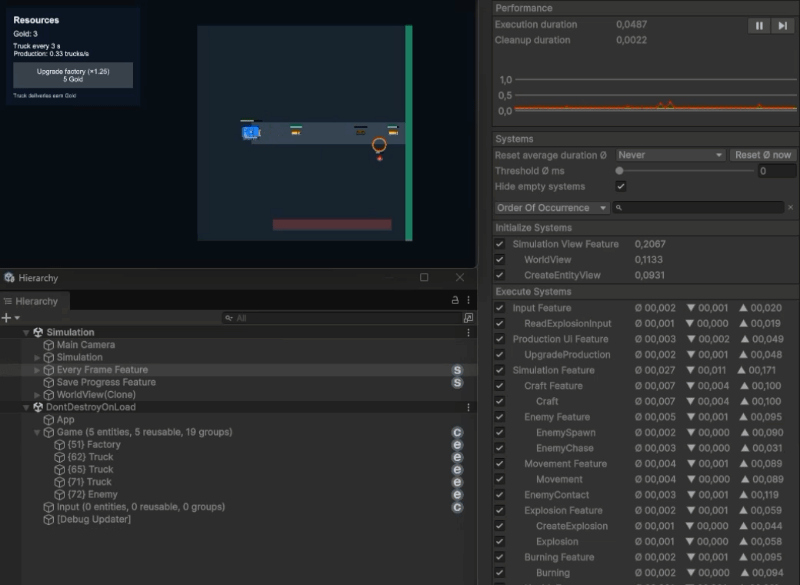

# Tiny Logistics

**Unity / C# — Hybrid ECS Architecture Demo**

Tiny Logistics is a small interactive Unity project focused on **game architecture rather than visual complexity**.

It demonstrates component-based gameplay behavior, a hybrid approach to state management, explicit system execution order, decoupled UI communication, application lifecycle management, and persistence.

## Gameplay

A factory automatically produces trucks that travel toward the edge of the map and earn Gold when successfully dispatched. Enemies spawn and chase trucks, exploding when they reach them.

The player can trigger explosions by clicking anywhere in the world. Explosions damage and ignite nearby entities, including friendly trucks and the factory itself. Earned Gold can be spent to upgrade the factory and accelerate production.

If the factory is destroyed, the current session ends and a new one begins.

The gameplay is intentionally minimal. Its purpose is to demonstrate how different game mechanics interact through reusable systems.

## Architecture

### 1. Composable behavior with Entitas ECS

**Entitas ECS** manages individual gameplay objects: factories, trucks, enemies, and explosions.

Entity behavior is defined by component composition rather than class inheritance.

For example, the same burning and health systems operate on factories, trucks, and enemies:

- `ExplosionSystem` finds entities with position and health components within an explosion radius, applies damage, and ignites surviving targets.
- `BurningSystem` processes entities with burning and health components, applying damage over time.
- `HealthSystem` handles death regardless of the entity's gameplay role.

These systems do not need separate implementations for each entity type. New objects can reuse existing mechanics by providing the required components.

**Code:** [ExplosionSystem](src/Tiny%20Logistics/Assets/Code/Simulation/Features/Explosion/Systems/ExplosionSystem.cs) · [BurningSystem](src/Tiny%20Logistics/Assets/Code/Simulation/Features/Burning/Systems/BurningSystem.cs) · [HealthSystem](src/Tiny%20Logistics/Assets/Code/Simulation/Features/Health/Systems/HealthSystem.cs)

### 2. Hybrid state management

Not all game state is stored in ECS components.

The project combines two approaches:

| Entitas ECS | Gameplay services |
|---|---|
| Individual objects and their lifecycle | Shared and aggregated simulation state |
| Position, health, movement, crafting progress, burning | Resource balances and production upgrades |
| Component-based processing | Explicit APIs for shared operations |

`StockpileService` stores resource balances in a `Dictionary<ItemId, long>` and provides operations for adding and consuming resources.

`ProductionService` manages factory upgrade rules and synchronizes production parameters with the relevant ECS entities.

This distinction keeps global resource accounting separate from individual world objects while allowing systems to work with both models.

The choice is based on data access patterns and architectural convenience, **not on an assumed performance advantage** over a pure ECS implementation.

**Code:** [StockpileService](src/Tiny%20Logistics/Assets/Code/Simulation/Features/Stockpile/Services/StockpileService.cs) · [ProductionService](src/Tiny%20Logistics/Assets/Code/Simulation/Features/Production/Services/ProductionService.cs)

### 3. Explicit system execution order

Gameplay logic is organized into Entitas `Feature` groups with a defined execution sequence.

The main simulation pipeline includes:

**Crafting → Enemy spawning and targeting → Movement → Enemy contact → Explosions → Burning → Health → Truck delivery**

The order is intentional. For example, movement updates positions before collision checks, and damage is processed before delivery rewards are calculated.

`EveryFrameFeature` coordinates input, UI commands, gameplay simulation, view synchronization, entity cleanup, periodic save requests, and deferred UI notifications.

This provides an explicit execution flow instead of distributing gameplay rules across unrelated `MonoBehaviour.Update()` methods.

**Code:** [SimulationFeature](src/Tiny%20Logistics/Assets/Code/Simulation/SimulationFeature.cs) · [EveryFrameFeature](src/Tiny%20Logistics/Assets/Code/Simulation/EveryFrameFeature.cs)

### 4. Decoupled UI communication

The UI communicates with gameplay through two different mechanisms:

- **RequestBroker** handles commands. For example, pressing the upgrade button publishes a request, which is later processed by `UpgradeProductionSystem`.
- **UiDispatcher** delivers notifications about state changes. Repeated signals of the same type are coalesced before dispatch, while payload events preserve individual event data.

`ProductionUiService` connects gameplay state to the presentation layer. The Unity UI does not directly modify resources or ECS components.

**Code:** [RequestBroker](src/Tiny%20Logistics/Assets/Code/Infrastructure/Broker/RequestBroker.cs) · [UiDispatcher](src/Tiny%20Logistics/Assets/Code/Infrastructure/UiDispatcher/UiDispatcher.cs) · [ProductionUiService](src/Tiny%20Logistics/Assets/Code/Simulation/Features/ProductionUi/UiServices/ProductionUiService.cs)

### 5. Application lifecycle and dependency injection

The application uses a state machine to manage startup, scene loading, session initialization, and gameplay:

**Boot → Loading → Initialization → Gameplay**

When the factory is destroyed and removed, the application returns to the loading flow and initializes a new session.

Dependencies are configured through **VContainer**. Gameplay systems are constructed through a system factory, allowing their dependencies to be supplied without relying on scene-object references.

**Code:** [Application states](src/Tiny%20Logistics/Assets/Code/Infrastructure/States/App) · [AppLifetimeScope](src/Tiny%20Logistics/Assets/Code/Infrastructure/LifetimeScopes/AppLifetimeScope.cs) · [SystemFactory](src/Tiny%20Logistics/Assets/Code/Infrastructure/Ecs/Systems/SystemFactory.cs)

### 6. Persistence

Saving and loading are implemented as separate system pipelines.

Each gameplay subsystem contributes its own state to a versioned snapshot. The snapshot includes resource balances, production upgrades, and persistent entity state such as positions, health, movement, crafting progress, and burning.

Transient effects and Unity object references are not serialized.

The persistence layer validates snapshots before restoration and writes JSON through a separate file storage abstraction.

**Code:** [SaveProgressFeature](src/Tiny%20Logistics/Assets/Code/Infrastructure/SaveLoad/Saving/SaveProgressFeature.cs) · [LoadProgressFeature](src/Tiny%20Logistics/Assets/Code/Infrastructure/SaveLoad/Loading/LoadProgressFeature.cs)

## Testing

The project includes unit and integration tests covering resource accounting, configuration validation, UI event dispatching, gameplay systems, production upgrades, combat interactions, persistence, and ECS/view lifecycle.

Startup integration tests also exercise the actual Boot scene, input handling, UI interaction, save restoration, and session restart.

**Code:** [Combat tests](src/Tiny%20Logistics/Assets/Tests/Editor/Integration/Simulation/CombatTests.cs)

## Design Trade-offs

This is an architecture showcase, not a production-ready game framework or a performance benchmark.

- **Architectural overhead:** ECS, dependency injection, state management, and messaging introduce complexity that would not be necessary for this gameplay alone.
- **Execution-order dependencies:** Systems communicate partly through shared state, making their execution order important and requiring integration testing.
- **Frame-driven simulation:** Gameplay uses delta-time updates rather than a deterministic fixed-step simulation.
- **Explicit persistence:** New persistent entity types require changes to snapshot capture, validation, and restoration.

The project illustrates one pragmatic way of combining ECS and service-based state management, without claiming it is universally preferable.

---

**Tech stack:** Unity 6 (6000.2.3f1), C#, Entitas / Jenny, custom code generators, VContainer, UniTask, Unity Input System, UGUI, Newtonsoft.Json, Unity Test Framework, NSubstitute.

**Unity project:** [`src/Tiny Logistics`](src/Tiny%20Logistics) · **Entry scene:** `Assets/Scenes/Boot.unity`